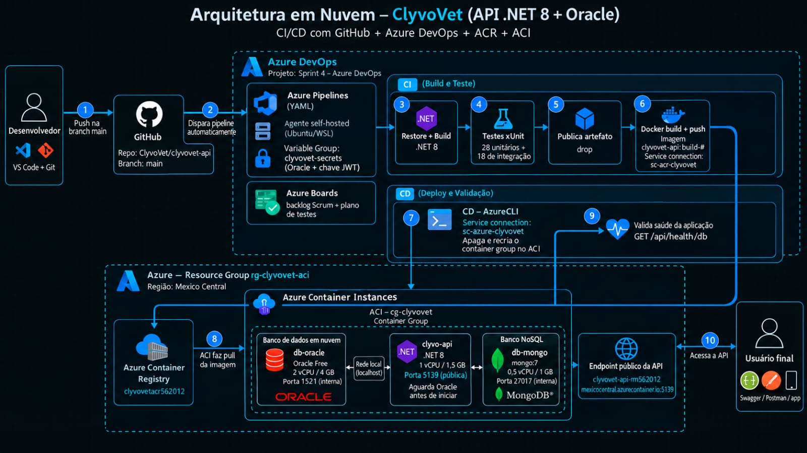

# ClyvoVet - API RESTful .NET 8

## Sobre o projeto

O **ClyvoVet** é uma API RESTful desenvolvida em **ASP.NET Core 8** para gerenciamento de tutores, pets, consultas veterinárias, medicações e histórico clínico.

A solução integra os seguintes recursos:

- Clean Architecture e Injeção de Dependência;
- tratamento global de exceções;
- API RESTful documentada com Swagger/OpenAPI;
- paginação, ordenação e filtros;
- HATEOAS nos endpoints de consulta;
- autenticação e autorização via JWT;
- persistência relacional com Oracle e Entity Framework Core;
- persistência NoSQL com MongoDB;
- padrão Repository;
- Health Checks, Serilog, OpenTelemetry e métricas;
- testes unitários e de integração com xUnit, Moq e padrão AAA;
- coleta de cobertura de testes com Coverlet.

---

## Índice

1. [Arquitetura](#arquitetura)
2. [Modelo de dados](#modelo-de-dados)
3. [Tecnologias](#tecnologias)
4. [Autenticação e autorização JWT](#autenticação-e-autorização-jwt)
5. [Paginação, ordenação, filtros e HATEOAS](#paginação-ordenação-filtros-e-hateoas)
6. [Persistência Oracle](#persistência-oracle)
7. [Persistência MongoDB](#persistência-mongodb)
8. [Tratamento global de exceções](#tratamento-global-de-exceções)
9. [Endpoints](#endpoints)
10. [Swagger / OpenAPI](#swagger--openapi)
11. [Monitoramento e observabilidade](#monitoramento-e-observabilidade)
12. [Testes automatizados](#testes-automatizados)
13. [Executando a aplicação localmente](#executando-a-aplicação-localmente)
14. [Docker](#docker)
15. [Migrations](#migrations)
16. [Integrantes](#integrantes)

---

## Arquitetura

O projeto está organizado em camadas, mantendo as responsabilidades separadas.

```text
ClyvoVet/
├── ClyvoVet.Api/
│   ├── Presentation/
│   │   └── Controllers/
│   ├── Application/
│   │   ├── Dtos/
│   │   ├── Helpers/
│   │   ├── Interfaces/
│   │   ├── Mappers/
│   │   └── UseCases/
│   ├── Domain/
│   │   ├── Entities/
│   │   ├── Errors/
│   │   ├── Interfaces/
│   │   └── Models/
│   ├── Infrastructure/
│   │   ├── Data/
│   │   │   ├── Migrations/
│   │   │   └── Repositories/
│   │   ├── Errors/
│   │   ├── IoC/
│   │   ├── Observability/
│   │   └── Security/
│   ├── Dockerfile
│   ├── docker-compose.yml
│   └── Program.cs
├── ClyvoVet.Tests.Unit/
│   ├── Application/
│   ├── Domain/
│   └── Infrastructure/
├── ClyvoVet.Tests.Integration/
│   ├── Controllers/
│   ├── Fixtures/
│   └── HealthChecks/
├── ClyvoVet.slnx
└── README.md
```

### Diagrama da solução


### Responsabilidade de cada camada

- **Presentation:** expõe os endpoints HTTP e traduz o resultado da aplicação em respostas HTTP.
- **Application:** contém os casos de uso, DTOs, mapeamentos, paginação e construção de HATEOAS.
- **Domain:** contém entidades, contratos de repositories, `OperationResult<T>` e erros do domínio.
- **Infrastructure:** implementa persistência Oracle/MongoDB, segurança JWT, observabilidade e DI.

A configuração das dependências fica centralizada em:

```text
ClyvoVet.Api/Infrastructure/IoC/Bootstrap.cs
```

---

## Modelo de dados

### Oracle - modelo relacional

```text
TUTOR
  └── 1:N PET
          ├── 1:N CONSULTA
          └── 1:N MEDICACAO
```

Tabelas relacionais:

- `TUTOR`
- `PET`
- `CONSULTA`
- `MEDICACAO`

A entidade `Tutor` continua sendo a identidade utilizada para cadastro e login. Não existe uma tabela separada `User` no modelo atual.

### MongoDB - modelo NoSQL

O MongoDB é utilizado para documentos de **histórico clínico**:

```text
historico_clinico
├── Id (ObjectId)
├── IdPet
├── DataRegistro
├── Tipo
├── Descricao
└── Tags[]
```

O histórico clínico foi mantido em NoSQL para demonstrar armazenamento de documentos flexíveis sem alterar o modelo relacional principal.

---

## Tecnologias

### Backend

- C#
- .NET 8
- ASP.NET Core Web API
- Entity Framework Core 8

### Persistência

- Oracle Database
- Oracle.EntityFrameworkCore
- MongoDB
- MongoDB.EntityFrameworkCore
- MongoDB.Bson

### Segurança

- Microsoft.AspNetCore.Authentication.JwtBearer
- JWT Bearer Token
- `[Authorize]` e `[AllowAnonymous]`

### Observabilidade

- Microsoft Health Checks
- AspNetCore.HealthChecks.Oracle
- Serilog
- OpenTelemetry
- System.Diagnostics.Metrics

### Documentação

- Swagger / OpenAPI
- Swashbuckle.AspNetCore
- Swagger Annotations

### Testes

- xUnit
- Moq
- WebApplicationFactory
- EF Core InMemory
- Coverlet Collector

---

## Autenticação e autorização JWT

A autenticação utiliza **JWT Bearer Token** para identificar o tutor e autorizar o acesso aos endpoints protegidos.

### Cadastro público

```http
POST /api/tutors
```

Exemplo:

```json
{
  "idTutor": 1,
  "nome": "Tutor Teste",
  "email": "tutor@teste.com",
  "telefone": "11999999999",
  "cpf": "123.456.789-00",
  "senha": "123456"
}
```

### Login público

```http
POST /api/tutors/login
```

```json
{
  "email": "tutor@teste.com",
  "senha": "123456"
}
```

Resposta:

```json
{
  "email": "tutor@teste.com",
  "jwt": "eyJhbGciOiJIUzI1NiIs...",
  "expiresAtUtc": "2026-10-23T04:00:00Z"
}
```

O token possui claims de:

- identificador do tutor;
- e-mail;
- nome de autenticação;
- role `tutor`;
- expiração.

Os endpoints de negócio utilizam `[Authorize(Roles = "tutor")]`, demonstrando autorização baseada em role. Cadastro e login utilizam `[AllowAnonymous]`.

### Configuração JWT

Em `appsettings.Development.json`:

```json
"Secretkey": "SUA_CHAVE_JWT_SEGURA"
```

A chave é lida diretamente por `builder.Configuration["Secretkey"]`. A validade do token é de 8 horas e fica definida no código. Em ambientes compartilhados ou de produção, a chave deve ser fornecida por configuração segura, como variável de ambiente:

```text
Secretkey
```

---

## Paginação, ordenação, filtros e HATEOAS

Os principais endpoints `GET` de coleção utilizam paginação por deslocamento.

Parâmetros comuns:

| Parâmetro | Descrição | Padrão |
|---|---|---:|
| `deslocamento` | quantidade de registros ignorados | `0` |
| `registroRetornado` | quantidade máxima de registros | `10` |
| `ordenarPor` | propriedade utilizada na ordenação | ID do recurso |
| `direcao` | `asc` ou `desc` | `asc` |

Exemplo:

```http
GET /api/pets?deslocamento=0&registroRetornado=10&especie=Cachorro&ordenarPor=nome&direcao=asc
Authorization: Bearer {token}
```

Resposta paginada:

```json
{
  "items": [
    {
      "idPet": 1,
      "idTutor": 1,
      "nome": "Thor",
      "especie": "Cachorro",
      "links": [
        { "href": "/api/pets/1", "rel": "self", "method": "GET" },
        { "href": "/api/pets/1", "rel": "update", "method": "PUT" },
        { "href": "/api/pets/1", "rel": "delete", "method": "DELETE" }
      ]
    }
  ],
  "deslocamento": 0,
  "registroRetornado": 10,
  "totalRegistros": 1,
  "links": [
    { "href": "/api/pets?...", "rel": "self", "method": "GET" },
    { "href": "/api/pets", "rel": "create", "method": "POST" }
  ]
}
```

### Filtros disponíveis

**Tutores**

- `nome`
- `email`

**Pets**

- `nome`
- `especie`
- `idTutor`

**Consultas**

- `idPet`
- `veterinario`
- `dataInicio`
- `dataFim`

**Medicações**

- `idPet`
- `nome`

**Histórico clínico (MongoDB)**

- `idPet`
- `tipo`

---

## Persistência Oracle

O `ApplicationContext` utiliza Entity Framework Core com Oracle.

Repositories concretos:

```text
TutorRepository
PetRepository
ConsultaRepository
MedicacaoRepository
```

O padrão Repository mantém o acesso a dados fora dos Controllers e UseCases.

A migration atual é uma `InitialCreate` limpa contendo somente as tabelas atuais do projeto.

---

## Persistência MongoDB

O contexto NoSQL está em:

```text
Infrastructure/Data/MongoApplicationContext.cs
```

Repository:

```text
HistoricoClinicoRepository
```

Caso de uso:

```text
HistoricoClinicoUseCase
```

Controller:

```text
HistoricosClinicosController
```

Configuração padrão:

```json
"ConnectionStrings": {
  "Mongodb": "mongodb://localhost:27017"
}
```

O nome do banco MongoDB é definido no `Bootstrap.cs` como `ClyvoVet`.

A coleção é criada/utilizada pelo MongoDB quando os documentos são persistidos.

---

## Tratamento global de exceções

A API utiliza um `IExceptionHandler` global:

```text
Infrastructure/Errors/GlobalExceptionHandler.cs
```

O tratamento centralizado padroniza erros inesperados e devolve respostas no formato `ProblemDetails`.

Mapeamentos principais:

| Exceção | HTTP |
|---|---:|
| recurso não encontrado | `404` |
| argumento/formato inválido | `400` |
| conflito de persistência EF Core | `409` |
| erro não tratado | `500` |

As Controllers não precisam repetir blocos `try/catch` genéricos em todos os métodos.

Além disso, a camada Application utiliza `OperationResult<T>` para padronizar fluxos esperados de sucesso e falha.

---

## Endpoints

> Endpoints protegidos exigem `Authorization: Bearer {token}`.

### Tutores

| Método | Endpoint | Autorização | Função |
|---|---|---|---|
| POST | `/api/tutors` | público | cadastrar tutor |
| POST | `/api/tutors/login` | público | autenticar e gerar JWT |
| GET | `/api/tutors` | JWT | paginação, filtros e HATEOAS |
| GET | `/api/tutors/{id}` | JWT | consultar tutor |
| PUT | `/api/tutors/{id}` | JWT | atualizar tutor |
| DELETE | `/api/tutors/{id}` | JWT | excluir tutor |

### Pets

| Método | Endpoint | Função |
|---|---|---|
| GET | `/api/pets` | paginação, ordenação, filtros e HATEOAS |
| GET | `/api/pets/{id}` | obter pet |
| GET | `/api/pets/tutor/{idTutor}` | filtrar por tutor |
| GET | `/api/pets/especie/{especie}` | filtrar por espécie |
| POST | `/api/pets` | cadastrar |
| PUT | `/api/pets/{id}` | atualizar |
| DELETE | `/api/pets/{id}` | excluir |

### Consultas

| Método | Endpoint | Função |
|---|---|---|
| GET | `/api/consultas` | paginação, ordenação, filtros e HATEOAS |
| GET | `/api/consultas/{id}` | obter consulta |
| GET | `/api/consultas/pet/{idPet}` | consultar por pet |
| POST | `/api/consultas` | cadastrar |
| PUT | `/api/consultas/{id}` | atualizar |
| DELETE | `/api/consultas/{id}` | excluir |

### Medicações

| Método | Endpoint | Função |
|---|---|---|
| GET | `/api/medicacoes` | paginação, ordenação, filtros e HATEOAS |
| GET | `/api/medicacoes/{id}` | obter medicação |
| GET | `/api/medicacoes/pet/{idPet}` | consultar por pet |
| POST | `/api/medicacoes` | cadastrar |
| PUT | `/api/medicacoes/{id}` | atualizar |
| DELETE | `/api/medicacoes/{id}` | excluir |

### Histórico clínico - MongoDB

| Método | Endpoint | Função |
|---|---|---|
| GET | `/api/historicos-clinicos` | paginação, filtros e HATEOAS |
| GET | `/api/historicos-clinicos/{id}` | obter documento MongoDB |
| POST | `/api/historicos-clinicos` | cadastrar documento |
| PUT | `/api/historicos-clinicos/{id}` | atualizar documento |
| DELETE | `/api/historicos-clinicos/{id}` | excluir documento |

### Monitoramento

| Método | Endpoint | Função |
|---|---|---|
| GET | `/api/health/live` | liveness da API |
| GET | `/api/health/db` | conectividade Oracle |
| GET | `/metrics` | métricas consolidadas |

---

## Swagger / OpenAPI

Com a aplicação em execução:

```text
http://localhost:5139/swagger
```

O Swagger possui esquema **Bearer JWT**.

Fluxo recomendado:

1. execute `POST /api/tutors` para cadastrar um tutor;
2. execute `POST /api/tutors/login`;
3. copie o valor `jwt`;
4. clique em **Authorize** no Swagger;
5. informe `Bearer {token}`;
6. teste os endpoints protegidos.

---

## Monitoramento e observabilidade

### Health Checks

```http
GET /api/health/live
GET /api/health/db
```

`live` verifica o processo da API e `db` verifica a conexão Oracle.

### Logging estruturado

Serilog registra em:

- console;
- `logs/api-AAAA-MM-DD.log`;
- níveis Information, Warning e Error;
- `CorrelationId`;
- `TraceId`.

### OpenTelemetry

Tracing configurado para:

- ASP.NET Core;
- HttpClient;
- `ClyvoVet.Application`;
- `ClyvoVet.Infrastructure`.

### Métricas

O middleware mede:

- quantidade total de requisições;
- quantidade total de erros;
- taxa de erros;
- tempo médio de resposta.

Endpoint:

```http
GET /metrics
```

---

## Testes automatizados

Os testes são separados em:

```text
ClyvoVet.Tests.Unit/
ClyvoVet.Tests.Integration/
```

São utilizados:

- xUnit;
- Moq;
- padrão AAA (`Arrange`, `Act`, `Assert`);
- WebApplicationFactory;
- Fixtures e Collection Fixtures;
- EF Core InMemory;
- autenticação de teste para endpoints protegidos;
- testes para JWT, HATEOAS, regras da camada Application e integração dos endpoints.

### Executar todos os testes

Na raiz:

```powershell
dotnet test .\ClyvoVet.Tests.Unit\ClyvoVet.Tests.Unit.csproj
dotnet test .\ClyvoVet.Tests.Integration\ClyvoVet.Tests.Integration.csproj
```

### Cobertura

O projeto mantém `coverlet.collector` para coleta de cobertura:

```powershell
dotnet test .\ClyvoVet.Tests.Unit\ClyvoVet.Tests.Unit.csproj --collect:"XPlat Code Coverage"
dotnet test .\ClyvoVet.Tests.Integration\ClyvoVet.Tests.Integration.csproj --collect:"XPlat Code Coverage"
```

Os testes também podem ser executados através do `Test Explorer` do Visual Studio.

Os resultados são gerados dentro de `TestResults`.

---

## Executando a aplicação localmente

### 1. Pré-requisitos

Instale:

- .NET SDK 8;
- Oracle Database acessível;
- MongoDB acessível (local, Docker ou Atlas);
- `dotnet-ef` caso precise manipular migrations.

### 2. Configurar credenciais Oracle

Edite:

```text
ClyvoVet.Api/appsettings.Development.json
```

O arquivo mantém a estrutura da connection string, porém **sem credenciais Oracle**:

```json
"OracleDbConnection": "Data Source=(DESCRIPTION=(ADDRESS_LIST=(ADDRESS=(PROTOCOL=TCP)(HOST=oracle.fiap.com.br)(PORT=1521))) (CONNECT_DATA=(SERVER=DEDICATED)(SID=ORCL)));User Id=;Password=;"
```

Preencha `User Id` e `Password` com as credenciais do banco que será utilizado:

```text
User Id=SEU_USUARIO;Password=SUA_SENHA;
```

Recomenda-se utilizar um usuário/schema Oracle exclusivo ou vazio para o ClyvoVet, evitando conflito com tabelas preexistentes que não estejam registradas no `__EFMigrationsHistory`.

### 3. Configurar MongoDB

O padrão local é:

```json
"Mongodb": "mongodb://localhost:27017"
```

Se utilizar MongoDB Atlas ou outro servidor, substitua pela connection string correspondente.

### 4. Configurar a chave JWT

Configure uma chave JWT adequada ao ambiente:

```json
"Secretkey": "SUA_CHAVE_SEGURA"
```

ou utilize a variável de ambiente:

```text
Secretkey
```

### 5. Restaurar dependências

Na raiz do repositório:

```powershell
dotnet restore .\ClyvoVet.Api\ClyvoVet.Api.csproj
```

### 6. Executar

```powershell
dotnet run --project .\ClyvoVet.Api\ClyvoVet.Api.csproj
```

A aplicação aplica as migrations Oracle pendentes durante a inicialização, exceto no ambiente `Testing`.

### 7. Validar

```text
Swagger:       http://localhost:5139/swagger
Health API:    http://localhost:5139/api/health/live
Health Oracle: http://localhost:5139/api/health/db
Metrics:       http://localhost:5139/metrics
```

---

## Docker

O `docker-compose.yml` contém:

- Oracle;
- MongoDB;
- API ClyvoVet.

Variáveis esperadas:

```text
ORACLE_ROOT_PASSWORD
ORACLE_APP_USER
ORACLE_APP_PASSWORD
JWT_SECRET_KEY
```

Depois:

```bash
docker compose up -d
```
## CI/CD e infraestrutura em nuvem (Azure DevOps)

A API .NET 8, o banco Oracle e o MongoDB rodam containerizados no **Azure Container Instances (ACI)**. Todo o ciclo, do commit ao ambiente no ar, é executado por uma esteira do **Azure Pipelines** conectada a este repositório, sem intervenção manual.

### Resumo

| Item | Valor |
|---|---|
| Projeto Azure DevOps | Sprint 4 – Azure DevOps — `https://dev.azure.com/Challenge-FIAP-2TDSPO/Sprint%204%20%E2%80%93%20Azure%20DevOps` |
| Pipeline | `azure-pipelines.yaml` (modo YAML, na raiz do repositório) |
| Gatilho | Push na branch `main` dispara CI e, em seguida, CD |
| Registro de imagens | Azure Container Registry (ACR) |
| Execução em nuvem | Azure Container Instances, container group `cg-clyvovet` (containers `db-oracle`, `db-mongo` e `clyvo-api`) |
| Banco de dados em nuvem | Oracle Free em container no mesmo grupo do ACI |
| Banco NoSQL | MongoDB (`mongo:7`) em container no mesmo grupo, usado pelo histórico clínico |
| Região | México Central |
| Agente da pipeline | Self-hosted (pool `Default`), porque a organização não possui paralelismo hospedado liberado |

### Diagrama da arquitetura e do fluxo CI/CD



### Etapas da pipeline

**CI — Build, testes e artefato**

1. Instala o .NET 8 SDK
2. `dotnet restore`
3. `dotnet build`
4. Testes automatizados com xUnit (28 unitários e 18 de integração); a pipeline falha se algum teste falhar
5. `dotnet publish` da API
6. Publica o artefato `drop` no Azure DevOps
7. Build da imagem Docker e push para o ACR, com as tags `<BuildId>` e `latest`

**CD — Deploy no ACI**, disparado quando o CI termina com sucesso

1. Obtém as credenciais do ACR em tempo de execução
2. Gera o manifesto do container group (Oracle, MongoDB e API) com os segredos vindos do Variable Group
3. Remove o container group anterior (o ACI não atualiza a imagem no lugar)
4. Cria o container group com os containers `db-oracle` e `clyvo-api`
5. Valida a aplicação em `GET /api/health/db`, com até 40 tentativas

O container `clyvo-api` espera o Oracle aceitar conexões e abrir o banco antes de iniciar. No ACI todos os containers sobem ao mesmo tempo e não existe `depends_on`. Os três containers dividem a rede do grupo, por isso a API acessa o Oracle em `localhost:1521` e o MongoDB em `localhost:27017`.

### Variáveis e segredos protegidos

Nenhuma credencial está no código ou no YAML. Os valores ficam no **Variable Group** `clyvovet-secrets` (Pipelines → Library), com cada variável marcada como *secret*:

- `ORACLE_ROOT_PASSWORD`
- `ORACLE_APP_USER`
- `ORACLE_APP_PASSWORD`
- `JWT_SECRET` (chave de assinatura do token, entregue à API como `Secretkey`)

O acesso à Azure usa **service connections**, sem senha no repositório:

| Service connection | Tipo | Uso |
|---|---|---|
| `sc-acr-clyvovet` | Docker Registry | Push da imagem no ACR |
| `sc-azure-clyvovet` | Azure Resource Manager | Criação do container group no ACI |

### Recursos na Azure

Resource group `rg-clyvovet-aci`, com o ACR e o ACI. Para consultar o ambiente:

```bash
az container show -g rg-clyvovet-aci -n cg-clyvovet --query "containers[].{nome:name,estado:instanceView.currentState.state}" -o table
az container logs -g rg-clyvovet-aci -n cg-clyvovet --container-name clyvo-api
```

### Como reproduzir

1. Faça uma alteração no código e dê push na branch `main`
2. Acompanhe a execução em Pipelines → clyvovet-api
3. Ao final, teste a aplicação:

```bash
curl http://clyvovet-api-rm562012.mexicocentral.azurecontainer.io:5139/api/health/db
```

Swagger: `http://clyvovet-api-rm562012.mexicocentral.azurecontainer.io:5139/swagger`

Os endpoints de negócio exigem JWT. No Swagger, cadastre o tutor em `POST /api/tutors`, faça login em `POST /api/tutors/login`, clique em **Authorize** e informe `Bearer {token}`.

### Evidência de persistência no banco

Os testes do CRUD são conferidos com `SELECT` dentro do Oracle:

```bash
az container exec -g rg-clyvovet-aci -n cg-clyvovet --container-name db-oracle --exec-command "/bin/bash"
sqlplus $APP_USER/$APP_USER_PASSWORD@localhost:1521/FREEPDB1
```

```sql
SELECT ID_TUTOR, NOME, EMAIL FROM TUTOR;
```

### Observação de operação

O ambiente é criado sob demanda e removido depois dos testes para preservar os créditos da assinatura. A pipeline o recria do zero a cada execução.

---

## Migrations

A pasta:

```text
ClyvoVet.Api/Infrastructure/Data/Migrations
```

contém a migration relacional do Oracle.

Para gerar uma nova migration:

```powershell
dotnet ef migrations add NomeDaMigration --project .\ClyvoVet.Api\ClyvoVet.Api.csproj --startup-project .\ClyvoVet.Api\ClyvoVet.Api.csproj --context ApplicationContext --output-dir Infrastructure\Data\Migrations
```

Para gerar o script SQL:

```powershell
dotnet ef migrations script --project .\ClyvoVet.Api\ClyvoVet.Api.csproj --startup-project .\ClyvoVet.Api\ClyvoVet.Api.csproj --context ApplicationContext --output script_bd.sql
```

As migrations EF Core se aplicam ao banco **relacional Oracle**. O MongoDB não utiliza as migrations relacionais do EF Core.

---

## Integrantes

- **Emanuel Italo** - RM: 561337
- **Enzo Monteiro Maciel** - RM: 563734
- **Gabriel Bebé Silva** - RM: 562012
- **Matheus de Almeida Sousa** - RM: 563557
- **Paulo Estalise** - RM: 563811

